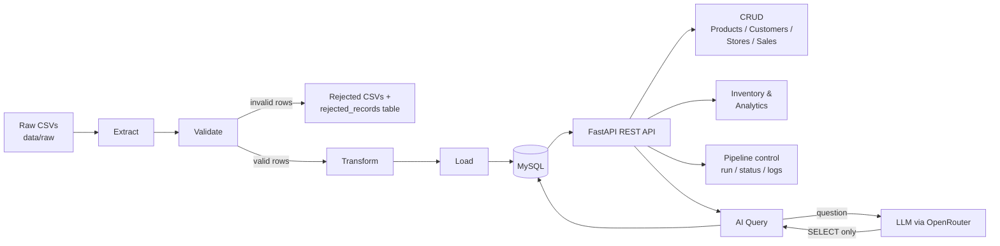

# Enterprise Retail Sales, Inventory & Supply Chain Analytics Platform


A backend platform that takes messy raw retail data, cleans it through an
automated **ETL pipeline**, stores it in **MySQL**, and serves it through a
**33-endpoint REST API** with JWT authentication, analytics, and an
**AI-powered natural-language query interface** ("Which store had the highest
sales?" → generated SQL → answer).

> Built as a 6-member team project and then extended with pipeline-as-a-service,
> JWT auth, and the AI query layer.

<!-- Add a screenshot of the Swagger UI here after you take it:

-->

---

## Highlights

- **Data quality first** — the pipeline validates every record and never drops
  bad data silently. In the bundled sample dataset, **250 records are
  ingested, 214 are loaded, and 36 are rejected and logged** with the reason.
- **Pipeline-as-a-Service** — trigger the ETL run with `POST /api/pipeline/run`;
  it executes in the background, with live status, run history, and log
  access over the API.
- **Safe AI-to-SQL** — an LLM turns plain English into SQL, but only a single
  read-only `SELECT` is allowed. Destructive keywords are rejected before the
  query reaches the database.
- **Secure by default** — bcrypt-hashed passwords, JWT bearer tokens, and all
  write endpoints protected. Secrets live in `.env`, never in code.
- **Layered, modular codebase** — routes, schemas, models, services, and the
  pipeline are separated, with centralized logging and custom exception
  handlers.

---

## Architecture



**Request flow for the AI endpoint**

1. User sends a plain-English question to `POST /api/ai/query`.
2. The LLM generates one SQL `SELECT` based on the database schema.
3. The query is validated (SELECT-only, destructive keywords blocked).
4. It runs against MySQL, and the result is returned with the generated SQL
   and a short natural-language answer.

---

## Tech Stack

| Layer          | Technology                          |
|----------------|-------------------------------------|
| API Framework  | FastAPI, Uvicorn                    |
| Database       | MySQL                               |
| ORM            | SQLAlchemy 2.0 (PyMySQL driver)     |
| Data Pipeline  | Pandas                              |
| Validation     | Pydantic                            |
| Auth           | JWT (PyJWT), bcrypt                 |
| AI Integration | OpenRouter (LLM API gateway)        |

---

## Quick Start

**Prerequisites:** Python 3.11+, a running MySQL server, and (optionally) a
free [OpenRouter API key](https://openrouter.ai/keys) for the AI endpoint.

```bash
# 1. Clone
git clone https://github.com/<your-username>/Enterprise-Retail-Platform.git
cd Enterprise-Retail-Platform

# 2. Virtual environment + dependencies
python -m venv venv
venv\Scripts\activate          # Windows
source venv/bin/activate       # macOS / Linux
pip install -r requirements.txt

# 3. Environment variables
cp .env.example .env           # Windows: copy .env.example .env
# open .env and fill in your values (see table below)

# 4. Create the database in MySQL (once)
#    CREATE DATABASE Retail_Sales_and_Supply_Chain_Analytics;

# 5. Create tables
python -m database.create_tables

# 6. Load sample data through the ETL pipeline
python -m pipeline.run_pipeline

# 7. Start the API
uvicorn main:app --reload
```

Open **http://127.0.0.1:8000/docs** for the interactive Swagger UI.

Expected pipeline summary:

```
Total Records Received : 250
Total Records Loaded   : 214
Total Records Rejected : 36
Pipeline Status        : SUCCESS
```

---

## Environment Variables

Copy `.env.example` to `.env` (the real `.env` is git-ignored).

| Variable             | Description                                                        |
|----------------------|--------------------------------------------------------------------|
| `DB_HOST`            | MySQL host (default `localhost`)                                   |
| `DB_USERNAME`        | MySQL username                                                     |
| `DB_PASSWORD`        | MySQL password                                                     |
| `DB_PORT`            | MySQL port (default `3306`)                                        |
| `DB_NAME`            | Database name                                                      |
| `JWT_SECRET_KEY`     | Long random string. Generate: `python -c "import secrets; print(secrets.token_hex(32))"` |
| `JWT_EXPIRY_MINUTES` | Token lifetime in minutes (default `60`)                           |
| `OPENROUTER_API_KEY` | API key from [openrouter.ai/keys](https://openrouter.ai/keys)      |
| `OPENROUTER_MODEL`   | Model ID. Default `openrouter/free` auto-picks an available free model |

> Free models on OpenRouter change often. `openrouter/free` avoids breakage
> when a specific model is retired. For consistent answers, set a specific
> model ID instead.

---

## API Overview (33 endpoints)

🔒 = requires a valid JWT bearer token. Read endpoints are public.

| Module     | Endpoints |
|------------|-----------|
| Auth       | Register, login, current user (`/api/auth/*`) |
| Products   | Create 🔒, list, get by ID, update 🔒, delete 🔒 |
| Customers  | Create 🔒, list, get by ID, update 🔒, delete 🔒 |
| Stores     | Create 🔒, list, get by ID, update 🔒 |
| Sales      | Create 🔒, list, get by ID, update 🔒, delete 🔒 |
| Inventory  | List, by store, low-stock alert |
| Analytics  | Top products, store-wise sales, daily sales trend |
| Pipeline   | Run 🔒, status, history, logs |
| AI         | Natural-language query |

The full, always-current list with request/response schemas is in the
auto-generated Swagger docs at `/docs`.

### Authentication

1. **Register:** `POST /api/auth/register` with `{ "username", "password" }`
   returns a JWT immediately.
2. **Login:** `POST /api/auth/login` (OAuth2 form). Also works with the
   **Authorize** button in Swagger UI.
3. **Use the token:** `Authorization: Bearer <your_token>`

---

## AI Query Example

**Request**

```http
POST /api/ai/query
Content-Type: application/json

{ "question": "Which store had the highest total sales?" }
```

**Response** (answer text abbreviated)

```json
{
  "question": "Which store had the highest total sales?",
  "sql_generated": "SELECT s.store_name FROM sales sl JOIN stores s ON sl.store_id = s.store_id JOIN products p ON sl.product_id = p.product_id GROUP BY s.store_id, s.store_name ORDER BY SUM(sl.quantity * p.unit_price * (1 - sl.discount_percentage/100)) DESC LIMIT 1",
  "row_count": 1,
  "data": [{ "store_name": "Star Bazaar" }],
  "answer": "<short natural-language summary>"
}
```

Returning the generated SQL alongside the answer makes every AI response
**auditable**: you can see exactly what was run against your data.

---

## Project Structure

```
├── api/                 # Route modules: products, customers, stores, sales,
│                        #   inventory, AnalyticsAPI, pipeline, ai, auth
├── auth/                # JWT creation/verification, password hashing
├── configs/             # Settings loaded from environment variables
├── database/            # DB connection + table creation script
├── Exceptions/          # Custom exceptions and global handlers
├── models/              # SQLAlchemy ORM models
├── schemas/             # Pydantic request/response schemas
├── services/            # Business logic (AI query service)
├── pipeline/            # ETL: extract, validate, transform, load, run
├── data/
│   ├── raw/             # Sample input CSVs
│   └── rejected/        # Records that failed validation
├── logger_config.py     # Centralized logging
├── main.py              # FastAPI app entry point
├── requirements.txt
└── .env.example
```

---

## Team

Built by a 6-member team as a training project.

| Name              | Module Owned                                |
|-------------------|---------------------------------------------|
| Mukund Chaturvedi | Initial setup, DB models, Products API      |
| Kriti Puri        | Data extraction, Stores API                 |
| Mrigank Rai       | Data validation, Customers API              |
| Aditya Chaturvedi | Data transformation, Sales API              |
| Saad Ahmed        | Pipeline execution, Inventory API           |
| Tanishka Tyagi    | Logging & exception handling, Analytics API |

Extensions beyond the original scope (pipeline-as-a-service, JWT auth, AI
query endpoint) were added after the training phase.

---

## Roadmap

- [ ] Automated tests (Pytest) and CI with GitHub Actions
- [ ] Dockerfile + `docker-compose` (API + MySQL) for one-command setup
- [ ] Role-based access control (admin-only endpoints)
- [ ] Upsert logic in the pipeline to update existing records
- [ ] Pagination and filtering on list endpoints
- [ ] Rate limiting on the AI query endpoint
- [ ] Frontend dashboard for analytics visualization

---

## Acknowledgements

Thank you to **Saurabh Aggarwal Sir** for his guidance and mentorship throughout
this project. His feedback pushed it from a training assignment to a
full-fledged platform.

---

## License

Built for educational and training purposes.
